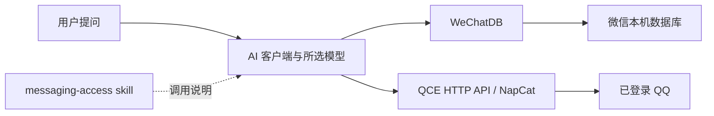

# messaging-access

[](https://github.com/Patr1ck2005/messaging-access/actions/workflows/validate.yml)

让支持本地工具的 AI 客户端，按需读取你自己的微信与 QQ 消息。

Windows 部署工具与共享 skill，复用 **wechatauto-replica / QCE Framework / NapCat**。支持最新消息读取、可取得历史的分页、消息分析和按需媒体读取。分析模型由你的客户端选择，可搭配 Codex、DeepSeek Harness 等具备文件和命令工具的客户端。



## 快速开始

准备 Windows 10/11 x64、PowerShell 7、Python 3.11 x64，以及你已安装的微信／QQ。已实测组合为微信 4.1.15.13、QQ 9.9.33.52230；客户端更新可能改变兼容性。

```powershell
git clone https://github.com/Patr1ck2005/messaging-access.git
Set-Location messaging-access
```

从项目目录运行。安装脚本创建隔离 Python 环境、按固定版本下载上游、校验主发布包摘要，并登记同源 skill。登录仍由你手动完成。

```powershell
# 微信读取环境与共享 skill
.\scripts\install.ps1

# 同时准备 QQ；QQ 路径无法自动找到时加 -QQExe <你的QQ.exe路径>
.\scripts\install.ps1 -EnableQQ -AcceptLanMetadataExposure

# 先正常完全退出普通 QQ，再从本项目启动
.\scripts\start-qq.ps1

# 检查环境和 QQ 接口，不输出聊天内容或密钥
.\scripts\check.ps1
```

QQ 的 `-AcceptLanMetadataExposure` 有实际含义：固定上游版本的 HTTP 服务监听所有网卡。消息等私有 API 使用随机 token 和本机来源 IP 白名单，但局域网可能访问静态页面与有限在线状态。详情见 [QQ 部署](docs/qq.md)。此接入的只读范围由调用流程限定，底层 token 没有细分的只读权限。

已有部署的程序、下载包和 token 会复用；安装脚本不启动或强行关闭 QQ，不改模型或 provider 配置。使用自定义 Python 路径时加 `-PythonExe <python.exe路径>`。更多参数以 `Get-Help .\scripts\install.ps1 -Detailed` 为准。

若 Windows 执行策略阻止本地脚本，审阅代码后可用 `pwsh -NoProfile -ExecutionPolicy Bypass -File .\scripts\install.ps1`（其他脚本同理）；该选项只作用于该进程，不修改系统执行策略。网络较慢时可显式传 `-PackageIndexUrl <HTTPS镜像地址>`，仅影响本次 pip 请求。

## 开始使用

在支持本地文件与命令工具的 AI 客户端中发送：

> 使用 messaging-access，读取微信和 QQ 最近一天的消息，整理需要我回复的事项。

首次验证可以只让它对各平台读一个会话，并报告条数、最新时间和刷新状态。技能入口在 `skills/messaging-access`；安装器将 Codex、通用 agents、DSH 的技能目录链接到这同一份源。若已打开的会话尚未发现它，重新打开会话或让模型显式读取这份 SKILL.md。

当前采用**提问时刷新读取**。普通网页聊天框没有本机执行工具时，不能直接使用这些本地接口。发送、自动回复、GUI 自动化与后台持续采集不在本项目范围。

## 缓存与磁盘

程序本体保持完整安装；运行数据可以查看与清理：

```powershell
# 默认只查看占用与可清理数量
.\scripts\cache.ps1

# 预演：清理 7 天前的可重建微信缓存
.\scripts\cache.ps1 -Action Clean -Category WeChatCache -OlderThanDays 7 -WhatIf

# 确认预览后执行
.\scripts\cache.ps1 -Action Clean -Category WeChatCache -OlderThanDays 7
```

普通微信查询复用固定的解密缓存，刷新后替换；QQ 消息查询使用有界内存缓存。媒体只在需要时提取，完整快照按需生成。媒体、快照、部分日志及 AI 客户端自己的对话历史仍可能累积；没有统一自动磁盘配额或后台清理任务。清理工具保留原始聊天库、账号密钥和程序，跳过未知文件、目录链接和使用中的文件。详情及媒体／日志清理见 [存储说明](docs/storage.md)。

## 配置与隐私

机器配置默认在 `%LOCALAPPDATA%/MessagingAccess/deployment.json`，路径结构见 [配置示例](config.example.json)。实际 token、密钥和解密数据库留在本机私有目录；不要将它们粘贴给模型。模型通过工具在请求进程内部使用凭据。

你要求分析的消息片段会进入当前 AI 客户端和所选模型的上下文；客户端自己的会话记录也可能保存工具输出。建议按时间、会话和任务取需要的内容。项目没有新增云端消息服务。详见 [隐私说明](docs/privacy.md)。

## 学习与维护

- [微信读取、历史与媒体](docs/wechat.md)
- [QQ 启动、认证与网络边界](docs/qq.md)
- [共享 skill 与直接 API 示例](skills/messaging-access/SKILL.md)
- [上游版本与摘要](upstream-lock.json)
- [第三方来源与许可](THIRD_PARTY.md)

读取范围是本机已同步、仍保留，或客户端能够取得的消息。手机独有、已删除、过期附件和特殊业务库可能缺失；不能把本地可取得历史称为账号全部云端历史。好友／群清单、最新页、历史分页与媒体可用性分别验收。

## 发布与开发检查

```powershell
# 清理逻辑只在合成目录中测试
.\tests\cache.Tests.ps1

# 生成并检查仅含公开源文件的候选包；不创建或上传 GitHub 仓库
.\scripts\prepare-release.ps1
```

公共仓库只包含脚本、配置模板、版本摘要、文档与 skill。上游二进制、虚拟环境、真实验收记录、凭据和聊天数据由部署者本机保存，不进入发布包。部署时从上游下载原发布物，并保留其许可约束。

本仓库新增的独立脚本与文档采用 MIT 许可；上游组件分别适用自己的许可，尤其 NapCat 的固定版本许可包含非商业使用限制。参见 [THIRD_PARTY.md](THIRD_PARTY.md)。
