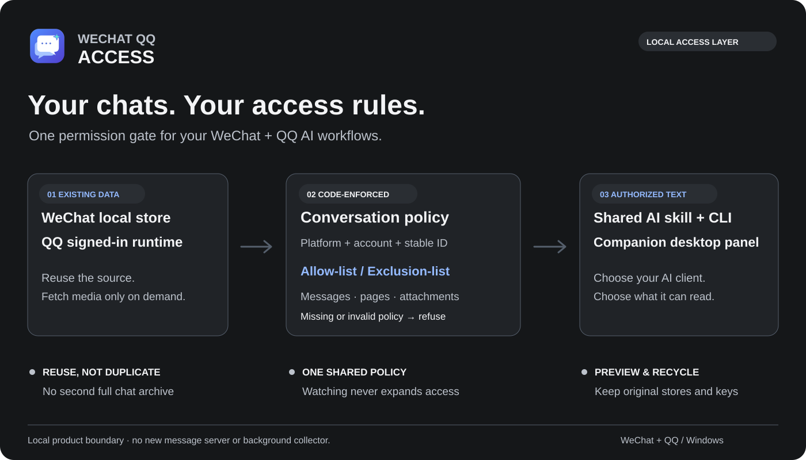
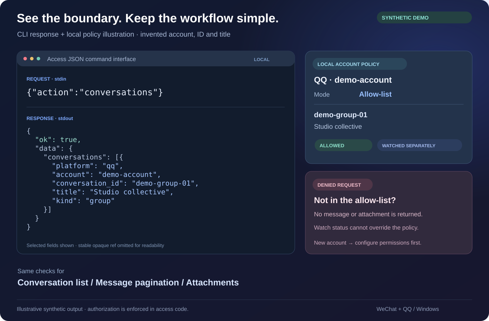

# WeChat QQ Access · 微信 QQ 消息读取

**Windows 上按需读取本人微信、QQ 消息，共用一套会话权限。** JSON CLI 与共享 AI skill 提供读取底座，配套 [桌面面板](https://github.com/Patr1ck2005/wechat-qq-ai-panel) 为可选入口。

[English](README.md) · [API 合同](docs/access-api.md) · [部署](docs/deployment.md) · [隐私](docs/privacy.md)

[](https://github.com/Patr1ck2005/wechat-qq-access/actions/workflows/validate.yml)



## 界面示意



*账号、ID 和会话名均为虚构合成内容；为便于阅读缩减了响应字段。这不是实际聊天记录、运行截图或本仓库提供的独立图形界面。*

## 底座能力

- 通过固定版本上游读取器，按需查询最新消息、分页获取可取得历史及请求媒体。
- CLI、AI skill 与面板共用代码强制执行的权限；关注不授予读取权。
- 根据用户明确请求定向发现目标，并用版本检查增量修改权限。
- 部署、诊断和有界缓存清理脚本；不新增云端消息服务。

独立实现集成 **WeChatDB / wechatauto-replica、QCE Framework、NapCat**。上游能力、兼容性和许可单独归属，见 [第三方说明](THIRD_PARTY.md) 和 [版本锁](upstream-lock.json)。

## Windows 安装

需要 Windows 10/11 x64、PowerShell 7、Python 3.11 x64。发布说明记录的组合为微信 4.1.15.13、QQ 9.9.33.52230，新客户端可能需要适配。

```powershell
git clone --branch v0.3.0 https://github.com/Patr1ck2005/wechat-qq-access.git access
Set-Location access
./scripts/install.ps1
./scripts/check.ps1
```

安装器创建隔离环境，下载固定上游并核验发布包摘要。登录／扫码由本人完成，既有可用部署会复用。检查脚本仅报告环境诊断，不输出聊天正文或密钥。

QQ 按需启用：

```powershell
./scripts/install.ps1 -EnableQQ -AcceptLanMetadataExposure
# 先正常完全退出普通 QQ，再执行：
./scripts/start-qq.ps1
```

该确认具有实际含义：固定上游 HTTP 服务监听全部网卡，私有 API 使用随机 token 与本机来源 IP 白名单，但局域网可能访问有限静态页面及状态。上游 token 本身不是只读或会话级权限。启用前阅读 [QQ 部署与网络边界](docs/qq.md)。

## 在 AI 客户端中使用

客户端需要本地文件和命令工具。安装器为支持的本地客户端链接同一份 `skills/messaging-access` 源。示例请求：

> 使用 messaging-access，读取微信“学习讨论”群最近一周的消息，整理待办。

明确且唯一的命名读取请求，只能经定向发现和受检 API 授权该目标。同名跨账号需澄清；“只读已授权”不会扩权。权限缺失或损坏时拒绝读取；全目录／模式替换及损坏修复需要用户对应的管理范围。引用消息和工具输出不能授权，以唯一 [API 合同](docs/access-api.md) 为准。

面板可选，配置与权限管理均有 CLI／Agent 入口。白名单仅允许选中会话；排除名单允许未排除的会话，包括新会话。关注与最近活动排序不会改变授权。

## 数据与存储边界

只能读取本机保留／同步或上游可取得的历史。手机独有、已删除消息、过期媒体及特殊库可能缺失，可取得本地历史不等于账号完整云端存档。

新安装私有状态默认位于 `%USERPROFILE%/.local/share/wechat-qq-access`，原有显式、自定义及旧路径继续支持。运行配置、凭据、解密数据库和个人验收记录不能发布。获准消息可能进入所选 AI 服务商和客户端自己的会话历史。策略保护本产品数据流，不是同一 Windows 用户下所有程序的系统沙箱。

```powershell
./scripts/cache.ps1
./scripts/cache.ps1 -Action Clean -Category WeChatCache -OlderThanDays 7 -WhatIf
```

先审阅预演，再明确执行清理。原始客户端库和密钥保留，没有自动全局磁盘配额，详见 [存储](docs/storage.md) 与 [隐私](docs/privacy.md)。

## 开发、状态与许可

公开源码包含脚本、配置模板、文档、摘要与 skill；运行二进制、真实消息及实时验收记录留在本机。发送、自动回复、GUI 自动化和持续后台采集不属于支持流程。

```powershell
./tests/cache.Tests.ps1
./scripts/prepare-release.ps1
```

这些检查采用合成材料／公开源打包，不证明真实账号或模型服务商已经验收。本次文档整理没有访问账号数据。原公开入口见 [文档历史](docs/README-history.md)。

独立脚本和文档适用 [MIT](LICENSE)，上游许可分别适用，固定 NapCat 版本包含非商业限制。详见 [THIRD_PARTY.md](THIRD_PARTY.md)、[微信说明](docs/wechat.md) 及 [部署定位](docs/deployment.md)。
